# Every moving part in 3D: the methodology

How the 3D analysis of the moving parts was done, for the Wempe Einheits-Chronometer and the Hamilton Model 21: what each step computes, from what, by which tool, with which assumptions, and how far its results were checked. The work was released in 3.22.00 (19 October 2026); its plan and history are in [`PLAN-motion-3d.md`](../../PLAN-motion-3d.md).

The results are in two places:
- **The viewers**, one for each chronometer, beside its report:
  - [the Wempe's](https://www.marinechronometermodel.com/wempe/verification/assets/motion3d/), with its report's [section 13](https://www.marinechronometermodel.com/wempe/verification/#m3d);
  - [the Hamilton's](https://www.marinechronometermodel.com/verification/build-verification/assets/motion3d/), with its build report's [section 14](https://www.marinechronometermodel.com/verification/build-verification/#m3d).
- **This page**, which gives the method behind them.

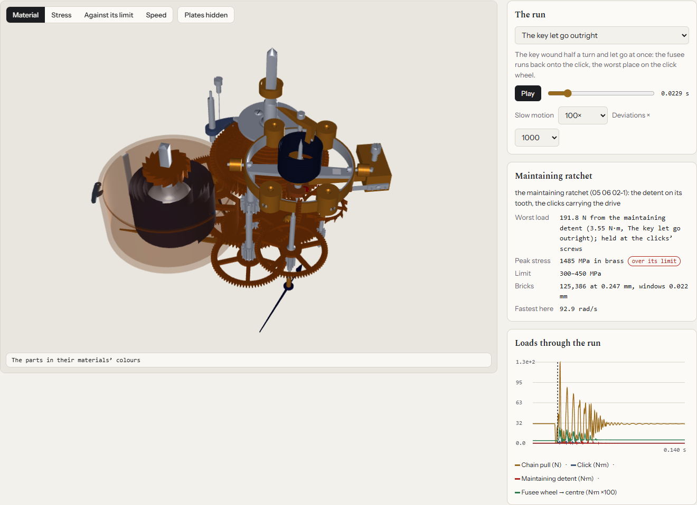

## The pipeline

Every number starts from the model itself. The geometry is the page's own solids, and each part's motion is the motion the page's own `update()` gives it. The forces come from running the whole transmission in time. Nothing is redrawn for the analysis.

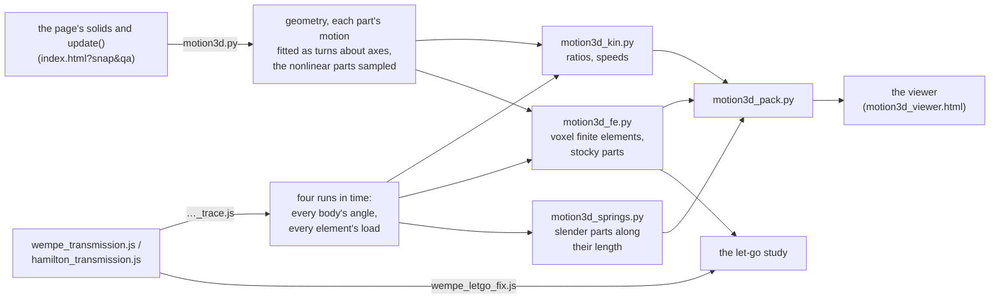

The tools are in [`marine-chronometer-source/chronometer-working-model/tools/`](../../marine-chronometer-source/chronometer-working-model/tools/). Every one takes `--model wempe` or `--model hamilton`.

| Step | Tool | What it writes | Time |
|---|---|---|---|
| 1. Geometry and motion | `motion3d.py` (with `motion3d-page.js` run in the page) | `r_motion3d/MODEL/meshes.json`, `geom.bin`, `samples.*` | 3–5 min |
| 2. Loads in time | `wempe_transmission_trace.js`, `hamilton_transmission_trace.js` (on `wempe_transmission.js`, `hamilton_transmission.js`) | `r_motion3d/MODEL/trace_VERSION.js` | about 1–2 min |
| 3. Kinematics | `motion3d_kin.py` | `kin_VERSION.json` | a second |
| 4. Stress, stocky parts | `motion3d_fe.py [--version last\|build] [--only a,b] [--fig DIR]` | `stress_VERSION.json`, `.bin` | 10–20 min a version |
| 5. Stress, slender parts | `motion3d_springs.py` | `springs_VERSION.json` | a few seconds |
| 6. The viewer's data | `motion3d_pack.py [--site DIR]` | `pack/` (private), or the report's `assets/motion3d/` | a few seconds |
| 7. The let-go study (the Wempe) | `wempe_letgo_fix.js` | `wempe/verification/assets/letgo_fix.json` | about 7 min |
| Pictures | `motion3d_shots.py`, `reportshot.py`, `motion3d_fe.py --fig` | the images on this page | about a minute each |

`r_motion3d/` is ignored by git; it is the working data, rebuilt by steps 1 to 5. What is committed is what the site serves: the viewer's packed data beside each report.

## 1. Geometry and motion, measured on the page

`motion3d.py` opens the model's page in Chromium and runs `motion3d-page.js` in it:
- **The base state.** It opens with `?snap&qa#drive=1`, which builds the moving parts with the mainspring and hairspring, and starts from a fixed state: the escape wheel at 1000 teeth, the balance at rest, the detent home, the fusee 4 turns from full wind.
- **The geometry.** It records every mesh shown, in the movement's frame (mm, dial side +y), with its part, piece and parts-list line. Positions are quantised to 16 bits within each mesh's own box.
- **The motion.** It nudges each input of `update()` by a small step: the escape wheel `E`, the balance angle `th`, the detent's `lift`, the trip spring's `psDef`, the fusee's turns `n`, the Wempe's maintaining spring `ms` and the Hamilton's sustaining spring `ssX`. It sees which meshes move and fits each move as a turn about a fixed axis: the unit axis, a point on it, the rate per unit of input, and the fit's miss in mm. Meshes turning together about one axis at one rate form a body.
- **The nonlinear parts.** Parts that don't simply turn are sampled over their range: the hairspring with the balance's angle (47 samples over ±2.3 rad), the barrel, chain, stop and up-and-down work over the fusee's turns (87 samples over the wind), the gold or trip spring with its bend, and the maintaining or sustaining spring with its lead.

`motion3d_kin.py` then checks each body's measured rate per escape-wheel tooth against the tooth counts. On both models every arbor of the train turns at its tooth counts' ratio to 0.1 %. In each run it also gives every body's fastest speed, its acceleration (the run's angles differenced on its own steps) and its largest departure from the train's rigid motion: the meshes' backlash and give, and the clicks' and detents' ride.

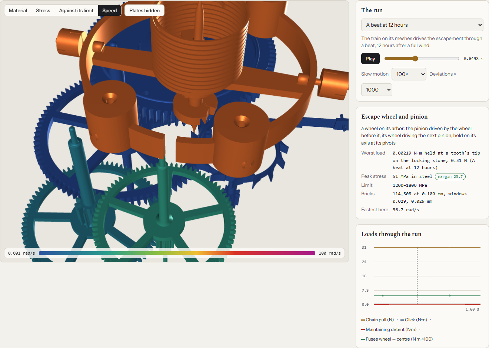

## 2. The loads: the whole transmission in time

The forces come from one nonlinear model of everything that moves. It is stepped in time at 1 µs, with each part a body carrying its inertia weighed on the model's solids, or estimated where nothing is weighed (said where). It is `wempe_transmission.js` for the Wempe and `hamilton_transmission.js` for the Hamilton. None of its elements is linearised:
- the mainspring's torque as solved, with its coils' stick-slip friction, so winding takes more than running gives;
- the chain, in tension only, so it can go slack and snatch; its lever on the fusee where it lies;
- each pawl (the clicks, the winding pawls, the maintaining detent, the sustaining pawl): a body on its pivot under its spring, riding the teeth's backs and catching a face only if it is down;
- the maintaining or sustaining spring, stiffening as it closes, with its bank;
- every mesh tooth by tooth on the page's own outlines: the driven gear's place under load through each pitch, the backlash to the back flank, the teeth's friction, contact on either flank or neither;
- the cannon pinion's friction fit, which slips past its torque;
- the key, with the Wempe's one-way coil spring;
- the stop;
- the escapement, `dynamics.js`'s own model in time.

Four runs give each part its worst moment:
1. a beat at 12 hours;
2. the key let go outright at the end of a stroke (the fingers off the paddle), at the worst place, with the nearer click 97 % of the way to the next;
3. the key eased back (its hold relaxed over 0.15 s);
4. the key wound into the stop.

`…_trace.js` writes each run's every body angle (the rigid motion and the departure from it) and every element's load for the viewer and the stress tools. For the Wempe there are two versions: as drawn (`last`) and the 1950s build (`MC_WREV=build`: its stronger mainspring at 1.26× the drive, in Nivaflex 45/5, and its thinned gold spring).

The stiffnesses no sheet gives (the teeth's give, the chain's, the clicks' faces, the bank) are estimated from the parts. The ones the blows rest on are varied in the transmission tool's own section 5 (the click's face ×¼ to ×2, the contacts' damping 2–20 %, the bank ×¼ to ×4, the chain 120–700 N/mm). The let-go blow stays 200–549 N over all of them.

## 3. Stress in the stocky parts: finite elements on their own solids

The wheels, pinions, arbors, the click wheel, the ratchets, clicks and pawls, the detents, the barrel and arbor, the fusee, the stop, the balance and the rollers are solved by `motion3d_fe.py`. It is linear-elastic and small-strain: the system's nonlinearity is in the runs that give the loads, and each part is solved at the worst force they find, applied quasi-statically (no stress waves). The steps:

1. **Voxels.** The part's pieces are voxelised together on one grid, about 110,000 to 260,000 bricks to a part. Each brick is solid or not by ray parity through the piece's closed mesh (`fea.py`'s method). Islands cut off by the grid (under 0.5 % of the largest piece) are dropped: unheld, they have no stiffness and the solver diverges.
2. **Materials.** Each brick takes its piece's material, read from the page's material colour: brass 100 GPa, steel 207 GPa, ruby 380, gold 98, beryllium copper 130. Poisson's ratio is 0.3 for every material.
3. **The element.** `fea.py`'s trilinear 8-node brick, its stiffness scaled by each brick's modulus, solved by conjugate gradients preconditioned with algebraic multigrid (`pyamg`).
4. **Holds.** A part is held where its real support takes the load, never by more than that support gives:
   - an arbor at its pivots, on the axis only, so the hold carries no torque, with the lower end held axially;
   - a wheel also where its drive comes in (the pinion's leaf from the wheel before it);
   - a pawl on its pivot's hole wall;
   - the fusee where the chain leaves it;
   - the maintaining ratchet at the clicks' screws;
   - the Hamilton's stud by its half nearer the bridge.
5. **Loads.** Each load goes where the run puts it:
   - a mesh's force at the pitch point, along the line of action, over the band where the wheel and the pinion it drives overlap (the Hamilton's fusee wheel, 2.22 mm thick, bears on its pinion over 1.40 mm; until 19 October 2026 the load was spread over the wheel's whole thickness: see section 6);
   - a pawl's blow on its tooth's face, at its contact from `mechanisms.py` off the built solids;
   - the escape torque at a tooth's tip on the locking stone;
   - the balance's inertia as a body force on every brick, from its angular acceleration at the turn and its speed at the centre.
6. **Fine windows.** Round each contact where the load comes in or goes out, a window is solved again on a finer grid, at about a ninth of the module (0.022–0.056 mm). Its cut faces are moved as the coarse solve moves them (prescribed displacements from the coarse field, inverse-distance weighted).
7. **Smoothing.** Each brick's von Mises stress is averaged with its 18 nearest bricks, about one brick each way. A voxel model's stair corners concentrate stress the real, smooth surface doesn't have.
8. **Reading the peak.**
   - In a window, the peak is read clear of the contact itself, by 3 bricks or 0.6 of the module, whichever is more, and two bricks in from the cut faces. The contact's own pressure is Hertz's and is given apart (the *Contact (Hertz)* line on a part's card).
   - On the coarse grid, the peak is the 99.5th percentile of the bricks clear of the holds and loads (0.3 mm or 2.5 bricks).
   - The part's peak is the higher of the two.
9. **The margin.** The peak is judged against its material's range: brass 300–450 MPa, its yield (the low-cycle blows of a wind); steel 1,200–1,800, hardened steel's yield; the mainspring against its strip's limit (2,600 MPa, the build's Nivaflex 3,000).

The figures below come from `motion3d_fe.py --fig`. Each draws one solve in plan. On the left is the whole part's coarse grid: each brick coloured by its stress, held nodes blue, loaded nodes red, and the dashed box marking the window. On the right is the window's finer grid: its cut faces grey, and the peak it reads marked +.

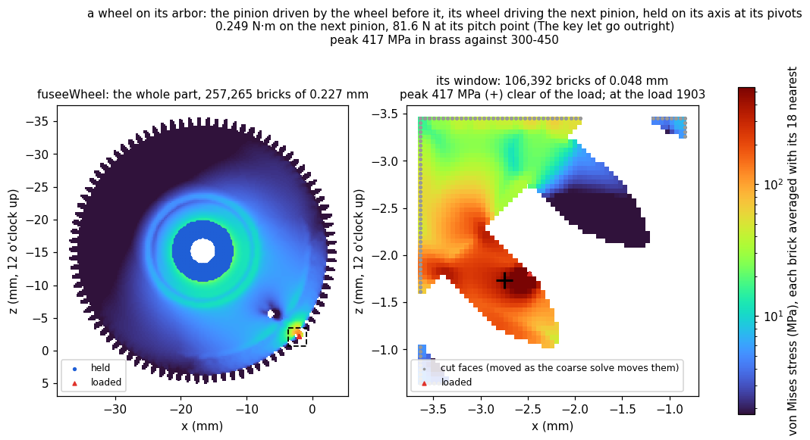

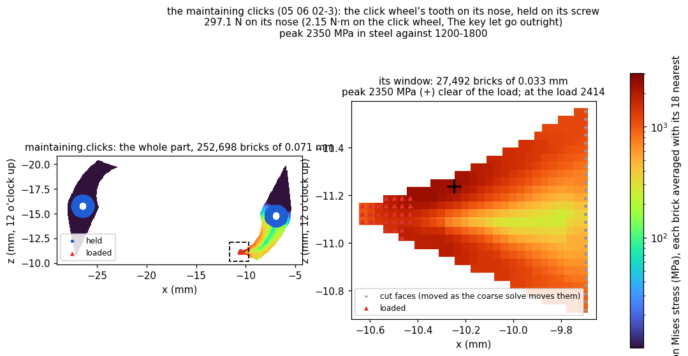

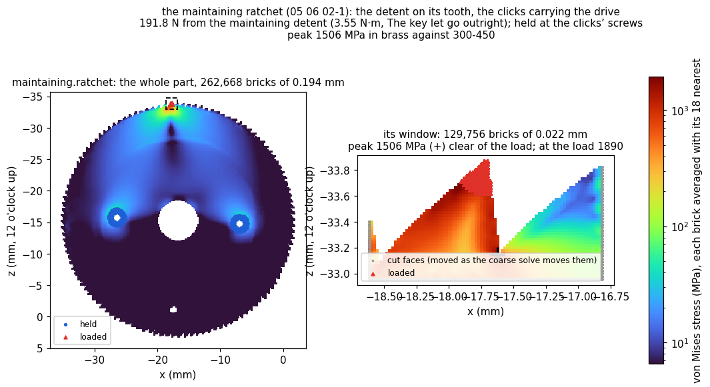

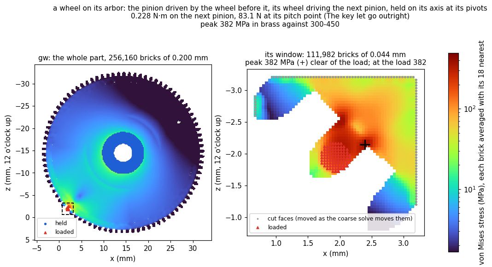

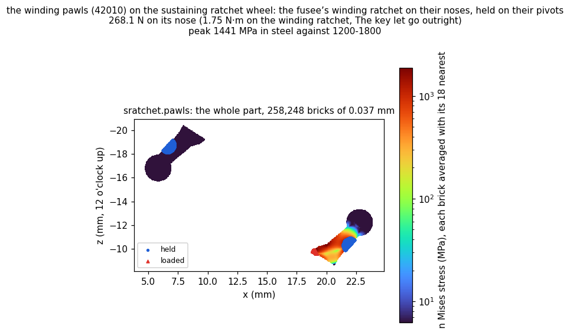

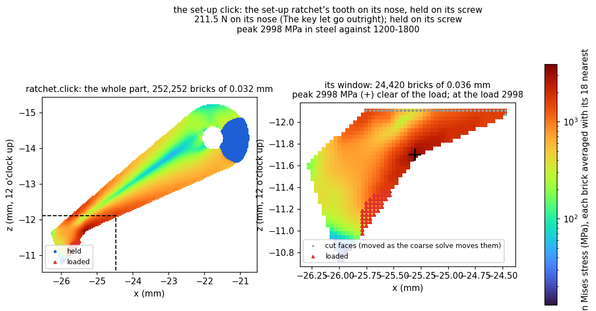

## 4. Stress in the slender parts: along their length

The springs bend through large angles, so their stress comes from their large-deflection solutions, which the model's own tools already have (`motion3d_springs.py` gathers them):

| Part | Stress | From |
|---|---|---|
| Mainspring | σ = E t/2 · \|κ − κ₀\| along the strip, at each solved state; κ₀ its free curve (mainspring.py's, scaled to the length and set) | `mainspring_wempe*.js`, `mainspring.js` |
| Hairspring | an even couple: 6kθ/(bh²), in MPa per radian of the balance | `wempe_hairspring.js`, `hairspring.js` |
| Maintaining or sustaining spring | the elastica's peak spread round the split ring, M(φ) ∝ (1 − cos φ)/2 from the eye | `wempe_sustaining.js`, `sustaining.js` |
| Detent spring | bent evenly by the lift: E t θ/(2L) | makeEsc's lift |
| Gold or trip spring | a cantilever from its bending point, bent at its tip as the stone passes | makeEsc's PS; `wempe_tripping.js` |
| Chain | the link plates' and rivets' stress per newton of pull | `wempe_strength.js` |

The viewer draws the mainspring as a ribbon through its solved states. It is placed on the page's own mesh of the spring by the best rotation (and mirror) between them: 0.24 mm apart for the Hamilton and 1.23 mm for the Wempe (both its versions): the ribbon shows where the stress lies along the strip, while the page's mesh stays the drawn spring.

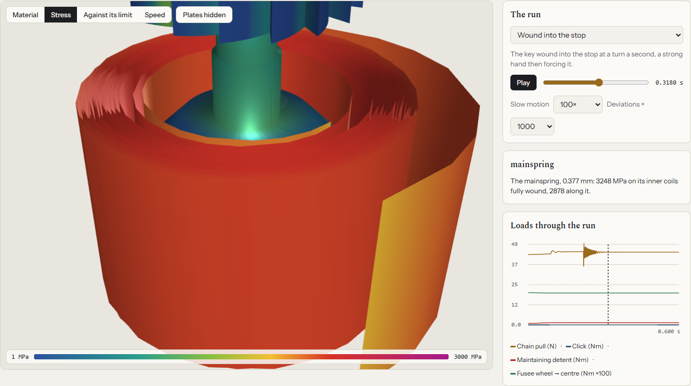

## 5. The viewer

`motion3d_pack.py` packs the geometry, each version's per-vertex stress (16-bit MPa), the runs' frames (every body's angle and every element's load, up to 2,500 frames a run) and the springs' states. `--site DIR` writes them for the site: gzipped binaries (unpacked in the browser), with three.js r128 and its OrbitControls from `vendor/` and the site's fonts beside them, so the page loads nothing from the network. `build.py` copies the folder with its report.

The viewer (`motion3d_viewer.html`):
- **Motion.** It plays each run in slow motion. Every body turns about its measured axis by the run's angle, and the departures from rigid motion can be magnified.
- **Colours.** It colours the parts by material, by stress (MPa on a log scale), by stress against the part's limit, or by speed.
- **Click a part** for its load, its peak, its limit, its bricks and its fastest speed.

`motion3d_shots.py` opens a viewer folder on a local port and checks that it loads clean: its data read, its parts table filled, no page error and nothing fetched off the folder. It then renders these stills through the viewer's own hooks (`window.__m3`).

| | |
|---|---|
| 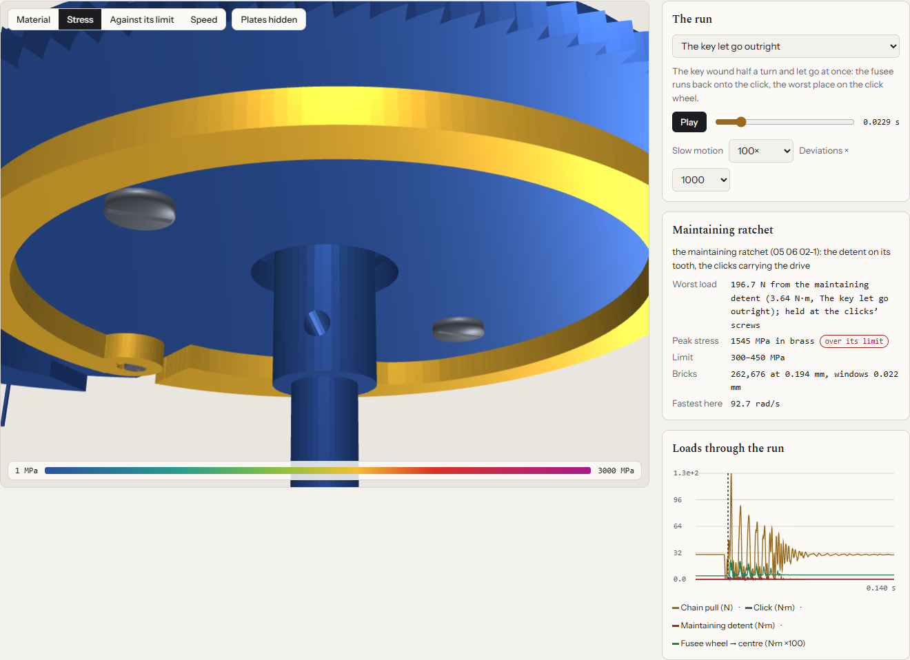 | 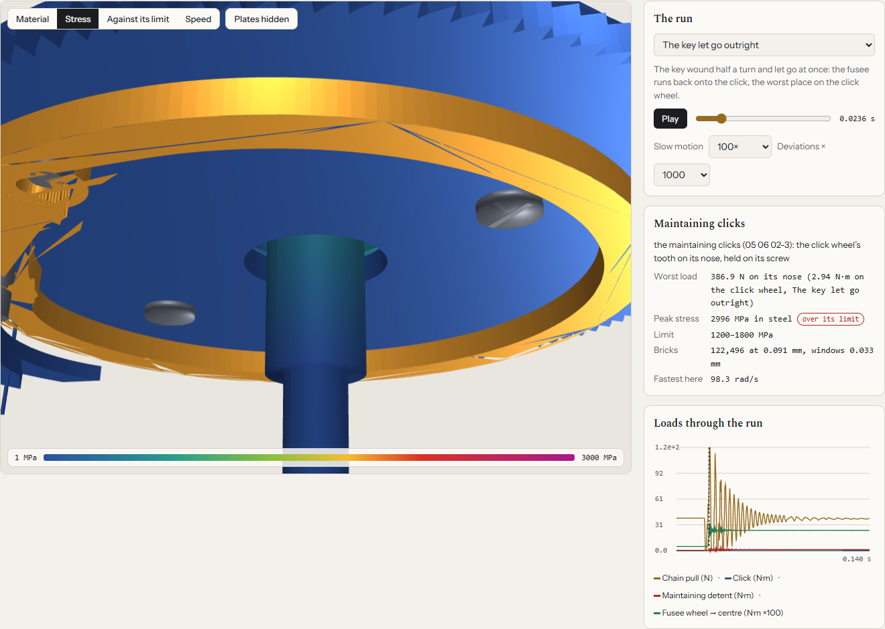 |
| 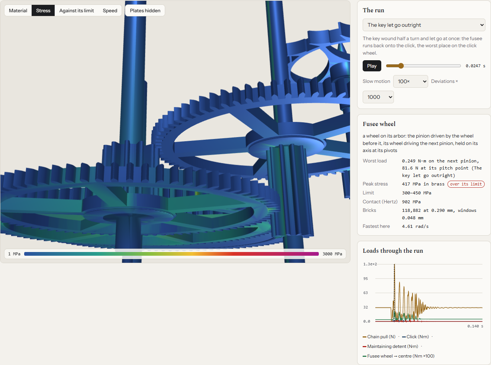 | 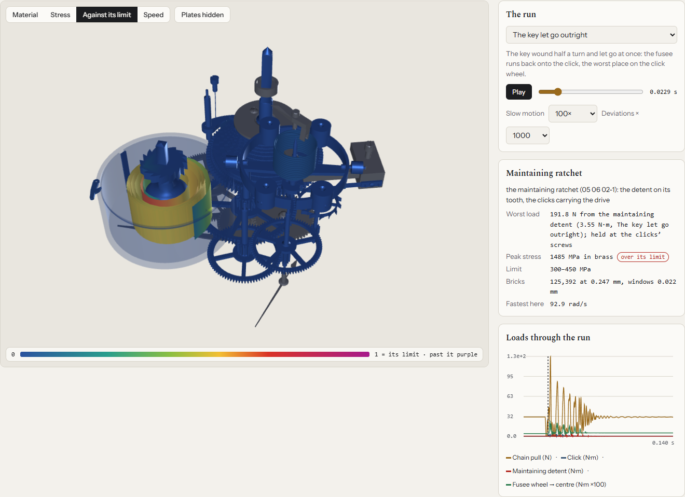 |
| 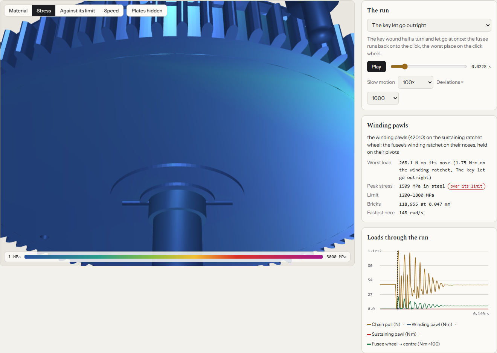 | 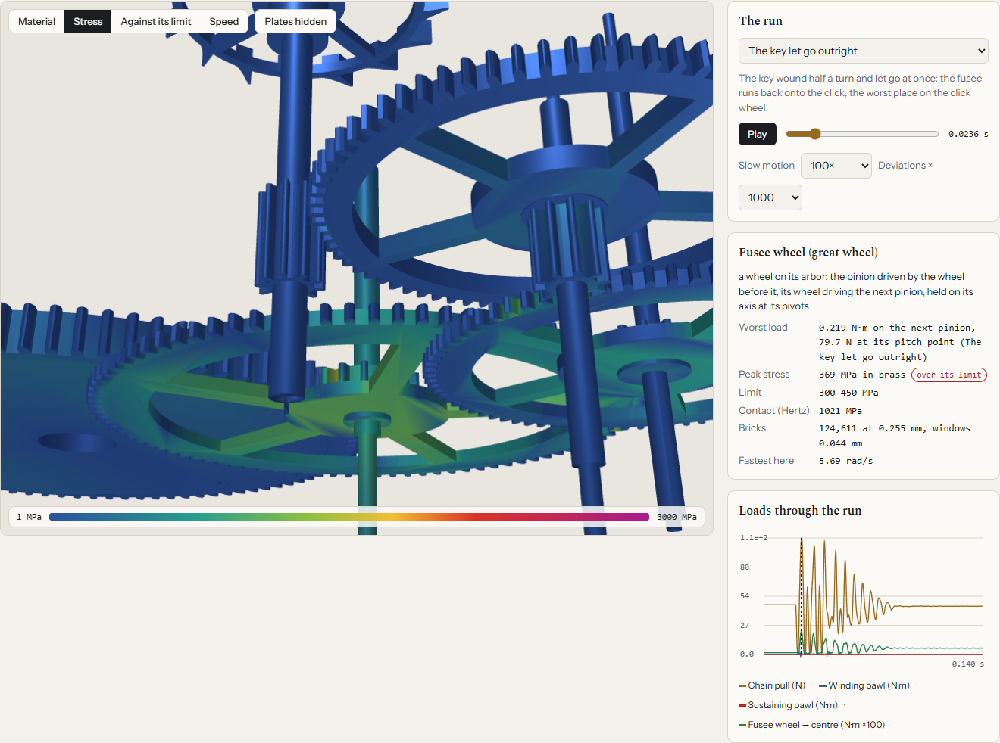 |
| 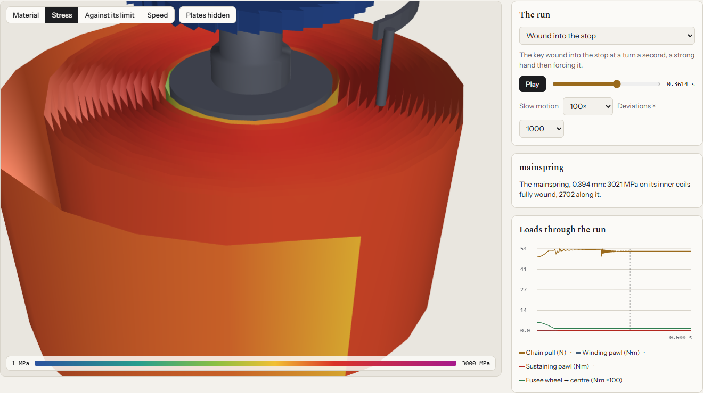 | 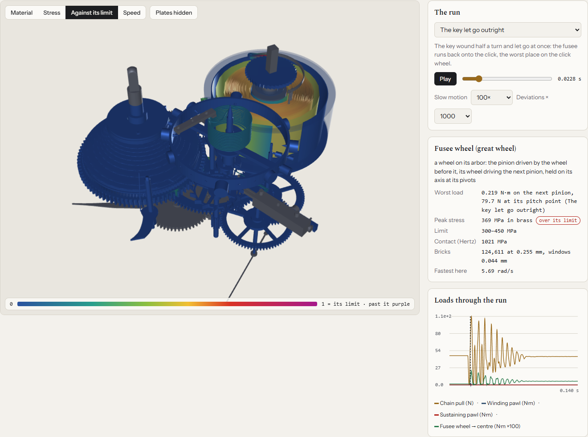 |

## 6. Cross-checks, and what they leave open

Each stress the finite elements give per newton of load, against the formula the model's strength tools use for the same part:

| Part, its load | FE (MPa per N) | Formula (MPa per N) | Reading |
|---|---|---|---|
| Wempe: fusee wheel to centre pinion, the wheel's tooth | 5.11 (417 at 81.6 N) | 4.37, Lewis in `wempe_strength.js` (87 at 19.9 N) | agree within 17 % |
| the same mesh, the centre pinion's leaf | 4.51 (368 at 81.6 N) | 4.37 | agree within 3 % |
| Hamilton: fusee wheel to centre pinion, the wheel's tooth | 5.43 (433 at 79.7 N) | 9.13, `strength.js` over the 1.40 mm bearing band (199 at 21.8 N); 5.75, Lewis over the tooth's whole 2.22 mm | agrees with Lewis over the whole tooth within 6 %; `strength.js` is the cautious figure |
| Hamilton: set-up ratchet's tooth | 1.74 (368 at 211.5 N) | 2.16, `ratchets.js`'s tooth root (313 at 145.1 N) | agree within 20 % |
| Wempe: set-up ratchet's tooth | 0.75 (190 at 253.7 N) | 0.40, `wempe_ratchets.js` (57 at 141.7 N) | FE 1.9× the formula |
| Wempe: click wheel's tooth, under the click | 0.60 (178 at 298 N) | 1.16, `wempe_ratchets.js` (57 at 49.1 N); 2.05, `wempe_strength.js` (105 at 51.2 N) | **the formulas differ from each other and from the FE**; open |
| Hamilton: winding ratchet's tooth, under a pawl | 0.96 (257 at 268 N) | 3.73, `ratchets.js` (110 at 29.5 N) | the formula is 3.9× the FE |
| Wempe: maintaining ratchet's tooth, under the detent | 7.74 (1,485 at 192 N) | 2.60, `wempe_ratchets.js` (50 at 19.2 N) | **the FE is 3× the formula**; open |
| Hamilton: set-up click, on its nose | 14.3 (3,017 at 211.5 N), at the contact itself | 3.71, `ratchets.js`'s arm in bending (539 at 145.1 N) | the FE's peak is the contact's, not the arm's |

What this means:
- **The train's teeth agree.** The finite elements and Lewis's formula agree on the Wempe's train, the best-defined case: a tooth at its pitch point, the formula's own setting.
- **The Hamilton's fusee wheel.** The FE first gave half of `strength.js`. Part of that was the FE's own error: it spread the tooth's load over the wheel's whole 2.22 mm instead of the 1.40 mm where the wheel bears on its pinion. Fixed, the tooth reads 433 MPa (it was 369). The rest is real. The tooth is 2.22 mm thick wherever it bears, so its whole root shares the bending, and Lewis's formula over the full 2.22 mm agrees with the FE within 6 %. `strength.js` takes only the bearing band, the cautious reading of the same tooth.
- **The ratchet teeth are where the methods part.** The formulas treat a short, stubby tooth as a slender cantilever loaded at its tip; the FE resolves its real shape. So where the FE is lower (the click wheel, the winding ratchet), the formula is likely the pessimistic one.
- **The pawls' and the maintaining ratchet's peaks lie near the load.** On the Wempe's clicks and the Hamilton's set-up click, the peak sits at the contact itself: the window's peak clear of the load is within 3 % of its peak at the load. On the Wempe's maintaining ratchet it is 0.6 of a module from the load. These parts are the ones past their limits at the let-go blow, and their peaks are the least certain figures here. A study refining the windows, with the load spread over Hertz's contact width rather than a patch of nodes, would settle them.
- **Every margin against the running loads holds by every method.**
- **Easing the key back keeps every part within its limit or at its floor**, however the let-go overloads are read.
- **The let-go study's click wheel column is the pessimistic figure.** It scales the tooth's stress by `wempe_strength.js`'s 2.05 MPa per N, the highest of the three readings; the FE's 0.60 would put the outright blow at 178 MPa, within brass.

## 7. The let-go study (the Wempe)

`wempe_letgo_fix.js` runs the transmission's own let-go simulation (`windRun`, in its threads):
- **Where.** At the worst place (the nearer click 97 % of the way to the next) and half way, with the key eased back beside each.
- **The fixes.** Each fix a maker could make, as estimates the transmission tool takes, its drawn values the defaults:
  - more clicks, evenly spaced over a tooth (`PAR.nck`), so the fusee runs a shorter way free;
  - a brake between the click wheel and the maintaining ratchet (`PAR.brk`, a Coulomb torque). The clicks hold those two together running, so it costs the train nothing, but the key works against it winding.
  - the click's face cushioned.
- **Each part's stress** is the 3D result's, scaled linearly to each case's force: the clicks by their blow on the click wheel, the maintaining ratchet and detent by the detent's blow on the ratchet, the fusee wheel by its teeth's load.

No fix keeps every part within its material, and the maintaining ratchet's brass is the last part over. The results are in the Wempe report's section 13:

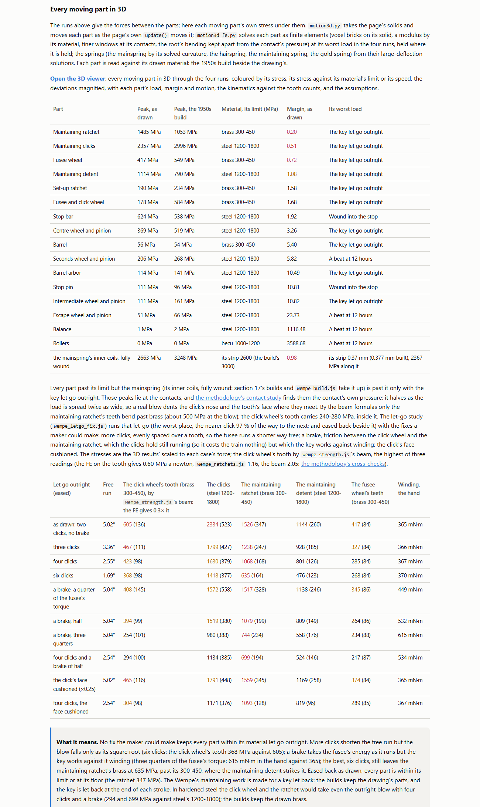

The Hamilton's results are in its build report's section 14:

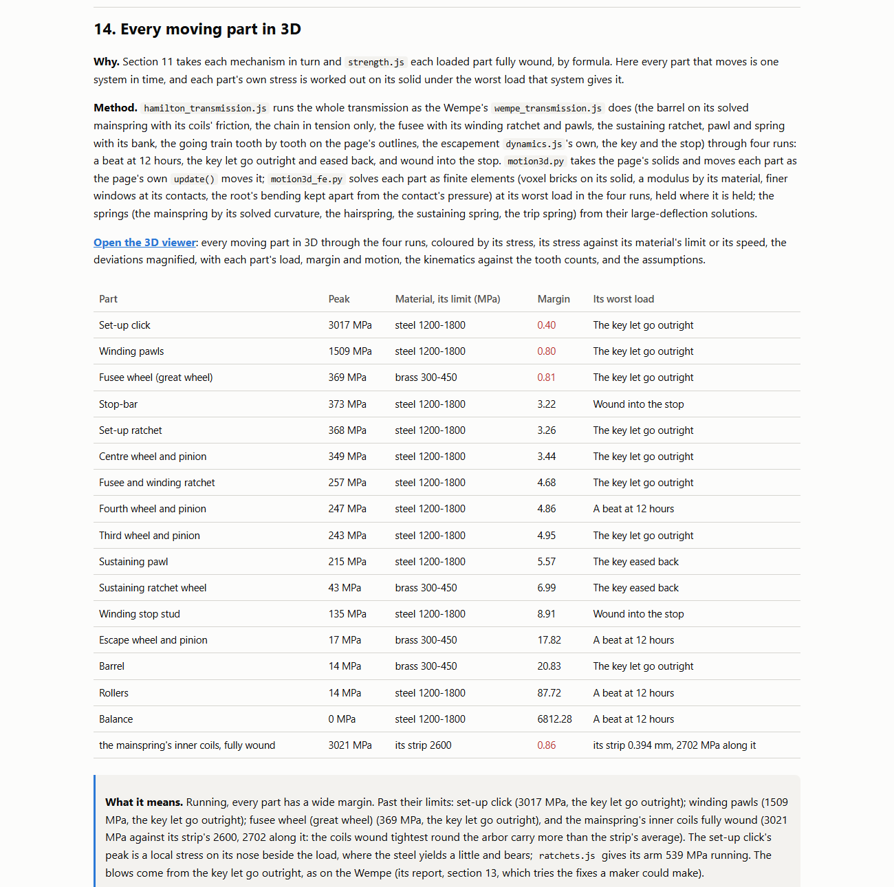

## 8. Assumptions and limits

- **The solids as made.** The page's solids are taken as made: their sizes as drawn, with no tolerance and no wear.
- **Motion.** Each part's motion is the page's own. The departures from rigid motion are the transmission run's, from its estimated stiffnesses.
- **Linear stress.** The stocky parts' stress is linear-elastic, at the runs' worst forces applied statically. A blow's stress waves are not modelled, and nothing yields: a peak past yield means the part would be dented there, not the stress it would actually reach.
- **Poisson's ratio** is 0.3 for every material. Each part takes its moduli from its material's colour on the page; the Wempe's impulse roller and the Hamilton's fusee wheel share a colour and are mapped by model.
- **Voxel resolution.** About 110,000 to 260,000 bricks a part, 0.04–0.43 mm, and windows at about a ninth of the module. The published results were solved at about 110,000 to 130,000 bricks a part. Six parts were solved again at the tool's default, about 255,000 bricks (the coarse grid about 1.25 times finer each way), with the same windows:

  | Part | Published | Refined | Change |
  |---|---|---|---|
  | Wempe fusee wheel | 417 MPa | 417 MPa | 0 % |
  | Wempe clicks | 2,357 | 2,357 | 0 % |
  | Wempe maintaining ratchet | 1,485 | 1,506 | +1.4 % |
  | Hamilton fusee wheel (before its bearing-band fix) | 369 | 366 | −0.9 % |
  | Hamilton winding pawls (no window) | 1,509 | 1,441 | −4.5 % |
  | Hamilton set-up click | 3,017 | 2,998 | −0.6 % |

  The coarse grid has settled. The windows were not refined further, and they are what the near-contact peaks rest on (section 6).
- **The limits** are ranges from published properties: brass Ms 58 spring-hard yield 300–450 MPa, hardened carbon steel 1,200–1,800, the strips' own. They are not measured on parts made to the model, since none are made.

## 9. Reproduce

From `marine-chronometer-source/chronometer-working-model/tools/`, for each model (`wempe` shown; the Wempe's 1950s build with `--version build` where a step takes it):

    python motion3d.py --model wempe
    node wempe_transmission_trace.js                      # MC_TR_OUT=r_motion3d/wempe/trace_last.js; MC_WREV=build for the build
    python motion3d_kin.py --model wempe [--version build]
    python motion3d_fe.py --model wempe [--version build] [--fig ../../../docs/motion-3d/img]
    python motion3d_springs.py --model wempe [--version build]
    python motion3d_pack.py --model wempe --site ../../wempe/verification/assets/motion3d
    node wempe_letgo_fix.js
    python ../../wempe/verification/build_report.py
    python motion3d_shots.py --model wempe --out ../../../docs/motion-3d/img/wempe
    python reportshot.py ../../wempe/verification/index.html m3d lfMeaning ../../../docs/motion-3d/img/wempe/report_section13.png

The Hamilton the same, with `hamilton_transmission_trace.js`, its report at `../verification/build-verification/` (section 14, `m3d` to `m3Meaning`) and `motion3d_pack.py --site ../verification/build-verification/assets/motion3d`. Then `python build.py --site-url https://www.marinechronometermodel.com` at the root.
